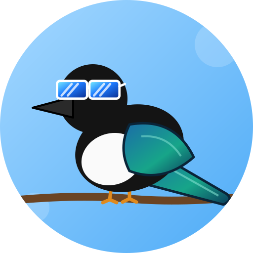

<p align="center">
  
</p>

# Сорока 🐦

Приватний Telegram-бот для двох: «сорока на хвості принесла».
Python 3.11+ · aiogram 3 (long polling) · yt-dlp + ffmpeg · Postgres (локально в Docker, у проді — Neon).

## Що вміє

- **Відео**: кидаєш посилання на TikTok / Instagram Reels / YouTube (відео та Shorts) — бот завантажує і постить нативне відео **в ту ж тему**, звідки прийшло посилання. Оригінал не видаляє.
  Якщо файл > 50 МБ — пробує нижчу якість, потім відповідає посиланням. Якщо завантаження впало — відповідає в образі.
- **Фільми**: `/movie_add Назва | Жанр`, `/movies` (за жанрами), `/movie_done <номер>`, `/movie_del <номер>` (видалити помилково доданий).
  Жанр можна не вказувати — тоді підтягнеться з TMDB (якщо задано `TMDB_API_KEY`), інакше «Без жанру». Відповіді йдуть у тему, позначену через `/here`.
- **Продукти та меню** (тимчасово): `/need`, `/needed`, `/got`, `/cook`, `/menu`, `/cooked`, а також `/need_del <номер>` і `/cook_del <номер>` для видалення. Відповіді — у тему, позначену через `/here`.
- `/setup` (в групі) і `/here` (в темі) — налаштування без `.env`.

Якщо команду написано не в «своїй» темі, бот відповідає у профільній і ставить 👌 на повідомлення.

## Тестовий запуск (локально)

### 1. Бот
1. У @BotFather: `/newbot` → отримай токен.
2. `/setprivacy` → обрати бота → **Disable** (інакше він не бачить посилання в групі).
3. (Опційно) `/setjoingroups` → Enable, якщо вимкнено.

### 2. Тестова група
1. Створи групу, додай туди дівчину (або пропусти для тесту), у налаштуваннях групи увімкни **Topics** — вона стане форумом.
2. Створи теми: наприклад «Фільми» та «Продукти» (відео підуть у ту тему, куди скинеш посилання).
3. Додай бота в групу й **зроби його адміністратором** (щоб надійно бачити повідомлення в темах).

### 3. Локальна БД
Запусти Docker Desktop, потім:

```bash
docker compose -f docker-compose.dev.yml up -d
```

### 4. Конфіг і запуск
```bash
cp .env.example .env        # впиши лише BOT_TOKEN (і за бажанням TMDB_API_KEY)
.venv/bin/python -m soroka  # (venv: python3.11 -m venv .venv && .venv/bin/pip install -r requirements.txt)
```
Потрібен `ffmpeg` у PATH (`brew install ffmpeg`).

### 5. Налаштування прямо в Telegram (без правок коду)
Групи й теми зберігаються в БД (таблиці `chats`, `config`), в `.env` їх нема. Бот працює в **кожній** групі, де його зареєстрували;
списки фільмів, продуктів і меню в кожної групи свої.
1. У групі напиши **`/setup`** — бот запам'ятає групу. Це може зробити лише **господар**: перший, хто виконав `/setup`
   (або `OWNER_ID` з `.env`, якщо задано). Інші отримають відмову, і в такій групі бот мовчить.
2. Зайди в тему для фільмів, напиши **`/here`** → «🎬 Фільми».
3. У темі для продуктів — **`/here`** → «🛒 Продукти й меню». «✖ Скинути» знімає призначення з теми.

Щоб змінити господаря, виконай у БД `DELETE FROM config WHERE key = 'owner_id';` (або задай `OWNER_ID`).
Прибрати групу: `DELETE FROM chats WHERE chat_id = ...;`

Далі кинь у групу посилання на Reel/TikTok/Shorts — і перевір `/movie_add Матриця`, `/need молоко`.

## Продакшн (Azure VM)

1. У `.env` заміни `DATABASE_URL` на рядок Neon (`?sslmode=require`).
2. Для Instagram: `cookies.txt` (Netscape-формат) з **додаткового** акаунта в корені проєкту (або `touch cookies.txt`).
3. ```bash
   docker compose up -d --build
   ```

Таблиці створюються автоматично при старті (`soroka/schema.sql`).

## CI/CD

`.github/workflows/deploy.yml`: на кожен push/PR перевіряється, що код компілюється й імпортується; на push у `main` після цього
по SSH оновлюється VM (`git reset --hard origin/main` + `docker compose up -d --build`). `.env` і `cookies.txt` на VM не чіпаються.

Потрібні GitHub Secrets (Settings → Secrets and variables → Actions): `SSH_HOST`, `SSH_USER`, `SSH_PRIVATE_KEY`, `SSH_KNOWN_HOSTS`.

## Підтримка

yt-dlp ламається разом з платформами — оновлюй регулярно:

```bash
docker compose build --no-cache && docker compose up -d
```

## Рішення за замовчуванням

| Питання | Зараз |
|---|---|
| Видаляти оригінальне повідомлення? | Ні (не реалізовано) |
| Завелике відео | Нижча якість → інакше посилання |
| Помилка / приватне посилання | Коротка відповідь у характері |
| Метадані фільмів | Вручну, або TMDB якщо жанр не вказано |
| Продукти в спільній БД з іншим застосунком | Окремі таблиці `groceries`, `meals` |
